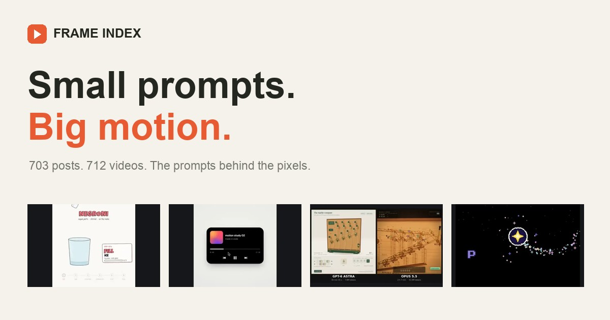

# Frame Index

A fast, searchable archive of creative coding videos and their prompts. Built for GitHub Pages, with the complete website in [`docs/`](docs).

**Live site:** [sunithvs.github.io/claude-edited-videos](https://sunithvs.github.io/claude-edited-videos/)



## The collection

- **703** unique X posts and their supplied prompts
- **712** video records associated with **691** posts, including videos linked through parent and quoted posts
- **691** locally generated video thumbnails
- **4** categories: motion (369), 3D (117), explainers (116), interactive (101)
- **207** prompts explicitly flagged as partial in the source
- **12** posts with unavailable video media; their prompts remain available

The original download pass saved and validated all 712 available videos, approximately 1.48 GB. **All MP4s are hosted as individual assets in the [videos-v1 GitHub Release](https://github.com/sunithvs/claude-edited-videos/releases/tag/videos-v1).** The website plays these downloaded copies first. Original public source URLs remain as fallbacks and attribution links.

Videos are complete, compact-quality copies (up to 360p where available), without additional transcoding. The media is stored in Releases rather than the Git history or `/docs`, keeping the Pages website lightweight. Thumbnails, prompts, catalog data, and SQLite remain in `/docs`.

### Download the videos

```sh
gh release download videos-v1 --repo sunithvs/claude-edited-videos --pattern '*.mp4' --dir videos
```

The [video file manifest](docs/data/video-files.json) includes every filename, post ID, byte size, SHA-256 checksum, and download URL. The release also contains this manifest.

The page sets `Referrer-Policy: no-referrer` through its HTML meta tag because the X video CDN rejects requests that include the GitHub Pages referrer. This keeps the original-source fallbacks usable.

## Website features

- Responsive thumbnail gallery with 24 cards per page increment
- Search across prompts, titles, creators, categories, and tags
- Category filters and newest, oldest, or creator sorting
- Saved favorites stored only in the visitor's browser
- Video viewer with multi-video switching and source attribution
- Supplied prompts with embedded local paths removed, partial-prompt notices, full retrieved post text, and copy action
- Native video controls, keyboard focus styles, Escape-to-close, and `/` search shortcut
- Downloadable [JSON catalog](docs/data/catalog.json) and [SQLite database](docs/data/videos.sqlite)
- Local WebP thumbnails, a social sharing cover, and an SVG favicon

No build step, framework, authentication, analytics, API key, or server backend is required. Google Fonts is an optional external stylesheet; system fonts are used if it is unavailable. Video media is fetched only when a visitor opens a post.

## GitHub Pages setup

Repository **Settings → Pages → Build and deployment**:

1. Source: **Deploy from a branch**
2. Branch: **main**
3. Folder: **/docs**
4. Save

All local asset and catalog URLs are relative, so the site works under the `/claude-edited-videos/` project path and on a custom domain. `docs/.nojekyll` disables Jekyll processing. The site uses hash navigation and query parameters, so no SPA rewrite rules are needed.

## Local preview

```sh
python3 -m http.server 8000 --directory docs
```

Open [localhost:8000](http://localhost:8000). Use a web server rather than opening `index.html` directly, since the catalog is loaded with `fetch`.

## Update the collection

The generation script accepts the local library directory containing `catalog.json` and downloaded MP4s from the original collection pass:

```sh
python3 -m pip install Pillow
python3 scripts/build_catalog.py /path/to/x-video-library
python3 scripts/make_cover.py
node --check docs/app.js
```

`ffmpeg` must be available. The script generates thumbnails from video frames, emits a portable catalog with no local absolute paths, and builds the SQLite database. Existing thumbnails are reused. No video files are copied to `docs`. The generated catalog points at the `videos-v1` Release by default; pass `--release-tag` to select another archive.

To resume uploads to an existing draft or published release, run:

```sh
python3 scripts/upload_videos.py /path/to/x-video-library --tag videos-v1
```

This requires an authenticated GitHub CLI. It skips uploaded files with matching sizes, retries failed uploads, and checks remote asset sizes and available SHA-256 digests before updating the manifest.

`make_cover.py` uses macOS system fonts; on other systems, change its font paths to installed TrueType fonts.

## Data and attribution

The supplied JSON is the prompt source. Public post metadata and source video URLs were resolved through FxTwitter, with supplied Skillry original-video mirrors used where needed. Prompt text preserves spelling, language, and incomplete excerpts. One embedded local file path in the supplied prompt collection is replaced with `[local file path removed]` in the public export; the original offline collection is unchanged. Full retrieved post text is stored separately. Missing titles are short excerpts from the supplied prompt; they are navigation labels, not claims about original post titles.

For prompt replies without attached video, the collector followed up to three parent posts, and it also checked quoted posts. The `sourcePost` and `relationship` fields preserve video provenance. The site always links to the original prompt post and the actual media source post.

The SQLite database contains `posts` and `videos` tables joined by `videos.post_id = posts.id`. It stores public URLs, not machine-specific local video paths. In JSON, videos are nested beneath their post.

All videos, images, and prompts belong to their respective creators. Inclusion is for reference and attribution and does not grant reuse rights. This is an independent community archive, not affiliated with Anthropic or X. To request a correction or removal, open a repository issue with the post URL.
